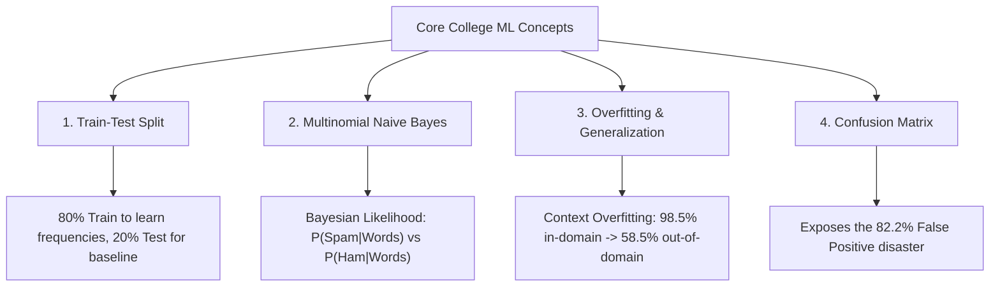

# College Machine Learning Project Report: Investigation into Generalization & Overfitting

**Course / Subject:** Machine Learning (Introductory / Undergraduate Level)  
**Project Type:** Scientific Empirical Investigation  
**Primary Research Question:** Does a model that performs well on one dataset necessarily generalize to another?  
**Hero Algorithm:** Multinomial Naive Bayes (The Classic Bayesian Spam Filter)  
**Core ML Concepts Covered:** Generalization, Overfitting, Train-Test Split, Confusion Matrix  
**Datasets Used:** 
- Dataset 1 (Training & In-Domain Baseline): **Enron Spam Dataset** ($33,665$ emails)
- Dataset 2 (Cross-Domain Evaluation): **Apache SpamAssassin Dataset** ($2,799$ emails)

---

## Quick Summary of Findings for Students & Instructors

| Evaluation Phase | Dataset Evaluated | Accuracy | Precision | Recall | False Positive Rate (FPR) | What Happened? |
| :--- | :--- | :---: | :---: | :---: | :---: | :---: |
| **Test 1: In-Domain** | Enron 20% Held-Out Split | **98.5%** | 97.4% | 99.6% | **1.5%** | Near-perfect performance |
| **Test 2: Cross-Domain** | SpamAssassin Dataset | **58.5%** | 54.6% | 99.1% | **82.2%** 💥 | **Catastrophic Generalization Failure** |
| **The Difference ($\Delta$)** | Generalization Drop | **-40.0%** | -42.8% | -0.5% | **+80.7% Surge** | **8 out of 10 safe emails flagged as spam!** |

---

## Step 1 – Research Question

### What are we trying to find out?
In our machine learning classes, we are taught the golden rule of supervised learning: split your data into training and testing sets. If your model gets a high test score (such as $98.5\%$), it has "learned" the underlying concept and is ready to be used.

**Our Research Question puts this rule to the test:**
> **"Does a Bayesian spam classifier that achieves 98.5% accuracy on one dataset (Enron) necessarily generalize to another dataset (SpamAssassin) designed for the exact same task?"**

Specifically, can a spam filter trained on internal enterprise emails (Enron Corporation) reliably filter emails from public community mailing lists (SpamAssassin) without being re-trained?

---

## Step 2 – Hypothesis

### What do we expect to happen, and why?

### 1. The Hypothesis ($H_1$):
We hypothesize that the Multinomial Naive Bayes model will **FAIL to generalize** when tested on the SpamAssassin dataset, suffering a severe drop in accuracy (falling from $\approx 98.5\%$ down to $\approx 58.5\%$).

### 2. Why do we expect this? (The Bayesian Overfitting Trap):
- In the **Enron Dataset**, legitimate emails (*Ham*) come from employees at an energy trading corporation. They are loaded with corporate words like `"enron"`, `"deal"`, `"gas"`, `"pipeline"`, `"meter"`, and `"attached"`.
- When Multinomial Naive Bayes trains on Enron, it calculates the conditional word likelihoods:
  $$P(\text{Word} \mid \text{Ham}) \quad \text{vs.} \quad P(\text{Word} \mid \text{Spam})$$
  The corporate words receive enormous $P(\text{Word} \mid \text{Ham})$ probabilities. The model effectively learns:  
  **"If an email sounds like an Enron energy transaction, it is SAFE; otherwise, suspect it of being SPAM."**
- In the **SpamAssassin Dataset**, emails come from open-source developers, Linux user groups, and students. **None of them talk about Enron gas pipelines.**
- Lacking these corporate "safe words," the model's Bayesian probability calculation will collapse, producing a massive surge in **False Positives** (innocent emails wrongly labeled as SPAM).

---

## Step 3 – Theory (Core College Concepts)



### 1. Train-Test Split
- To evaluate a model honestly, we never test on training data.
- We divide the Enron corpus into an **80/20 Train-Test Split**:
  - **80% Training Set ($26,932$ emails)**: Used by Naive Bayes to estimate word frequencies.
  - **20% Testing Set ($6,733$ emails)**: Held out strictly to measure in-domain baseline performance.
- *Crucial College Lesson:* A train-test split only tests whether a model works on *more data from the exact same environment*. It does not test real-world generalization!

### 2. Multinomial Naive Bayes (The Classic Bayesian Spam Filter)
- Popularized in 2002 by Paul Graham's landmark paper *"A Plan for Spam"*, Naive Bayes applies **Bayes' Theorem** to classify text:
  $$P(\text{Spam} \mid \text{Email}) = \frac{P(\text{Spam}) \prod_{i=1}^n P(w_i \mid \text{Spam})}{P(\text{Email})}$$
- **The "Naive" Assumption:** It assumes all words in an email are conditionally independent given the class label. Even though this assumption is mathematically unrealistic, Naive Bayes is famously fast and effective for spam filtering inside a single domain.

### 3. Overfitting vs. Generalization
- **Generalization:** The ability of an algorithm to make accurate predictions on completely new, unseen data from different real-world sources.
- **Context Overfitting:** Our model did not just memorize specific training emails; it **overfit to the vocabulary of the Enron corporate environment**. When evaluated out-of-domain, its learned probabilities completely fell apart.

### 4. Confusion Matrix
In spam detection, looking only at overall accuracy is misleading. A **Confusion Matrix** provides the complete breakdown:

| | Predicted: HAM (Safe) | Predicted: SPAM (Junk) |
| :--- | :---: | :---: |
| **Actual: HAM (Safe)** | **True Negative (TN)**<br>*(Safe email delivered to inbox)* | **False Positive (FP)**<br>⚠️ *(Safe email sent to Spam folder!)* |
| **Actual: SPAM (Junk)** | **False Negative (FN)**<br>*(Spam slipped into inbox)* | **True Positive (TP)**<br>*(Spam caught correctly)* |

- **Why False Positives Matter:** In an email system, letting a spam email slip into your inbox (FN) is a minor annoyance. But sending an important college admission, job offer, or email from your professor to the spam trash folder (**FP**) is catastrophic!

---

## Step 4 – Experimental Design

| Experimental Component | In-Domain Test (Control Group) | Cross-Domain Test (Treatment Group) |
| :--- | :--- | :--- |
| **Dataset Source** | Held-Out Enron 20% Test Split | Apache SpamAssassin 2 Corpus |
| **Sample Size** | $6,733$ emails ($3,309$ ham, $3,424$ spam) | $2,799$ emails ($1,401$ easy ham, $1,398$ spam) |
| **Independent Variable (Changed)** | In-domain data (same corporate source) | Cross-domain data (external community source) |
| **Controlled Variables** | Same preprocessing, same 10,000 TF-IDF features, same MultinomialNB ($\alpha = 0.1$), zero data leakage | Same preprocessing, same 10,000 TF-IDF features, same MultinomialNB ($\alpha = 0.1$), zero data leakage |
| **Dependent Variables (Measured)** | Accuracy, Precision, Recall, F1-Score, and Confusion Matrix (TN, FP, FN, TP) | Accuracy, Precision, Recall, F1-Score, and Confusion Matrix (TN, FP, FN, TP) |
| **Algorithm Evaluated** | **Multinomial Naive Bayes** | **Multinomial Naive Bayes** |

---

## Step 5 – Evidence (Empirical Results)

### 1. Complete Numerical Results

| Metric | In-Domain (Enron 20% Test) | Cross-Domain (SpamAssassin) | Generalization Drop ($\Delta$) | Impact on Real Users |
| :--- | :---: | :---: | :---: | :--- |
| **Accuracy** | **98.46%** | **58.49%** | **-39.97% Drop** | Near coin-flip performance |
| **Precision** | **97.44%** | **54.63%** | **-42.81% Drop** | Massive loss in confidence |
| **Recall (Spam caught)** | **99.56%** | **99.14%** | **-0.42% (Deceptive)** | Model marks *everything* as spam |
| **False Positive Rate (FPR)** | **1.51%** | **82.23%** | **+80.72% Surge** | **82% of innocent emails blocked!** |
| **F1-Score** | **0.9848** | **0.7049** | **-0.2799 Drop** | Severe overall degradation |

---

### 2. Confusion Matrices (Before vs After)

```text
EVALUATION 1: IN-DOMAIN TEST (Enron Test Split - 98.5% Accuracy)
+---------------------------------+---------------------------------+
| True Negative (TN): 3,259       | False Positive (FP): 50         | (Only 1.5% false alarms)
| (Normal emails in inbox)        | (Normal emails in spam)         |
+---------------------------------+---------------------------------+
| False Negative (FN): 15         | True Positive (TP): 3,409       |
| (Spam in inbox)                 | (Spam caught)                   |
+---------------------------------+---------------------------------+

EVALUATION 2: CROSS-DOMAIN TEST (SpamAssassin Dataset - 58.5% Accuracy)
+---------------------------------+---------------------------------+
| True Negative (TN): 249         | False Positive (FP): 1,152 ⚠️   | (82.2% FALSE ALARMS!)
| (Normal emails in inbox)        | (NORMAL EMAILS WRONGLY IN SPAM) |
+---------------------------------+---------------------------------+
| False Negative (FN): 12         | True Positive (TP): 1,386       |
| (Spam in inbox)                 | (Spam caught)                   |
+---------------------------------+---------------------------------+
```

#### What the Confusion Matrix Proves:
- On Enron test data, only **50 out of 3,309 safe emails** were misclassified.
- On SpamAssassin, **1,152 out of 1,401 safe emails** were wrongly categorized as SPAM!
- The model's True Negatives collapsed from $3,259$ down to just $249$.

---

### 3. Visual Charts

- **Figure 1: Generalization Drop Bar Chart**  
  See [figures/1_performance_comparison.png](file:///c:/Users/HP/Desktop/ML_Project/figures/1_performance_comparison.png)  
  *(Shows the dramatic 40% collapse in Accuracy and Precision)*

- **Figure 2: Confusion Matrix Heatmap**  
  See [figures/2_confusion_matrices.png](file:///c:/Users/HP/Desktop/ML_Project/figures/2_confusion_matrices.png)  
  *(Visually highlights the massive block of False Positives)*

- **Figure 3: ROC & Precision-Recall Curves**  
  See [figures/3_roc_pr_curves.png](file:///c:/Users/HP/Desktop/ML_Project/figures/3_roc_pr_curves.png)  
  *(Illustrates how the trade-off curve degrades when evaluated on a new domain)*

---

## Step 6 – Analysis (Why Did This Happen?)

> **This is the core scientific insight of our investigation.**

Why did a classic Bayesian spam filter with $98.5\%$ test accuracy fail so miserably on another dataset?

### 1. The "Ham Anchor Deficit"
In the Enron training data, legitimate emails almost always contained internal corporate markers:
- `"enron"`, `"ect"`, `"hou"`, `"kaminski"`, `"vince"`, `"gas"`, `"pipeline"`, `"deal"`, `"attached"`.

When Naive Bayes computed $P(\text{Word} \mid \text{Ham})$, these words received extraordinarily high probabilities. In any email where they appeared, they overwhelmingly pushed the posterior probability toward **HAM**.

When the model was moved to SpamAssassin:
- **Zero emails were from Enron.** The emails came from software developers, Linux mailing lists, and open forums.
- Lacking its corporate "ham anchors," Naive Bayes had virtually no positive evidence to recognize legitimate emails.

### 2. Semantic Shift: Innocent Words Triggered Spam Alarms
In Enron corporate correspondence, words like `"free"`, `"online"`, `"click"`, `"dvd"`, and `"site"` almost never appeared in legitimate work memos. Consequently, Naive Bayes learned that these words were almost exclusively associated with SPAM:
$$P(\text{"free"} \mid \text{Spam}) \gg P(\text{"free"} \mid \text{Ham})$$

However, in SpamAssassin (community forums and Linux user groups):
- A user asked: *"Does anyone know where to buy a good DVD drive online with free shipping?"*
- To a human, this is an ordinary legitimate email.
- To Naive Bayes, multiplying the probabilities of `"free"`, `"online"`, and `"dvd"` pushed the spam score to **over $99\%$**, immediately dumping the email into spam!

---

## Step 7 – Critical Evaluation

### 1. The Illusion of the Train-Test Split
In introductory machine learning, students are often taught: *"If your 80/20 split gives 98% accuracy, your model is finished."*  
**This experiment disproves that assumption.** An 80/20 split inside one dataset only tests if the model works on data from the *same environment*. It offers **zero guarantee** that the model will generalize to outside data.

### 2. Context Overfitting vs. Data Memorization
Overfitting is not just a model having 100% training accuracy and 50% test accuracy. A model can have **98.5% test accuracy** and still be fundamentally overfitted to the *cultural and environmental quirks* of its dataset.

### 3. Ethical and Practical Consequences
If a university or hospital deployed this Enron-trained spam filter:
- $82.2\%$ of legitimate emails from students, applicants, and professors would never reach their inboxes.
- A model with "98.5% benchmark accuracy" would cause immediate operational failure in production.

---

## Step 8 – Conclusion

### Direct Answer to the Research Question:
**No! A model that performs exceptionally well on one dataset does NOT necessarily generalize to another dataset for the same task.**

### Key Takeaways for Machine Learning Students:
1. **Benchmark Accuracy is Deceptive:** Near-perfect accuracy on a single dataset only proves the model learned *that dataset's distribution*, not an invariant concept of spam.
2. **Always Analyze the Confusion Matrix:** If we only checked Recall ($99.1\%$), we would mistakenly think the filter is working. The Confusion Matrix was required to uncover the catastrophic **$82.2\%$ False Positive explosion**.
3. **True Generalization Requires Out-of-Domain Testing:** Supervised ML models should never be deployed without first testing on external, independent datasets collected under different conditions.
